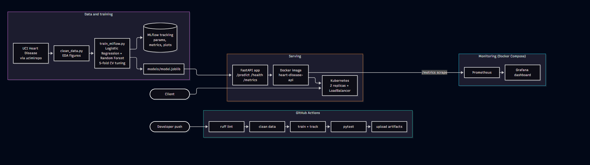

# Heart Disease Risk Prediction: End-to-End MLOps

Binary classifier predicting heart disease risk from the UCI Heart Disease (Cleveland) dataset,
with experiment tracking, CI/CD, Docker, Kubernetes deployment and monitoring.



## Results (5-fold CV on the training split, mean ± std)

| Model | Accuracy | Precision | Recall | ROC-AUC |
|---|---|---|---|---|
| Logistic Regression (selected) | 0.847 ± 0.010 | 0.877 ± 0.054 | 0.783 ± 0.046 | 0.902 ± 0.014 |
| Random Forest | 0.814 ± 0.024 | 0.817 ± 0.040 | 0.774 ± 0.096 | 0.899 ± 0.030 |

Held-out test set (61 rows): Logistic Regression ROC-AUC 0.966, Random Forest 0.947.
The selection is by cross-validated ROC-AUC. The two models are statistically close.

## Setup (Windows PowerShell, Python 3.11)

```powershell
git clone https://github.com/tancred27/mlops-assignment.git
cd heart-disease-mlops
py -3.11 -m venv .venv
.venv\Scripts\Activate.ps1
pip install -r requirements.txt -r requirements-dev.txt
```

## Run the pipeline

```powershell
python -m src.data.download_data      # fetch dataset via ucimlrepo -> data/raw/heart.csv
python -m src.data.clean_data         # -> data/processed/heart_clean.csv
python -m src.data.eda                # figures -> reports/figures/
python -m src.models.train_mlflow     # train, tune, log to MLflow, save models/model.joblib
mlflow ui --backend-store-uri sqlite:///mlflow.db
ruff check .
pytest -v
```

## Serve the model

```powershell
docker build -t heart-disease-api:1.0 .
docker run -d -p 8000:8000 heart-disease-api:1.0
$body = Get-Content sample_input.json -Raw
Invoke-RestMethod -Uri http://localhost:8000/predict -Method Post -Body $body -ContentType "application/json"
```

## Kubernetes (Docker Desktop, kubeadm cluster)

```powershell
kubectl apply -f k8s/
kubectl get deployments,pods,svc
# API available at http://localhost:8080
```

## Monitoring

```powershell
docker compose up -d --build
python scripts/generate_traffic.py --n 300
```
Prometheus: http://localhost:9090, Grafana: http://localhost:3000 (admin / admin), dashboard "Heart Disease API".

## Repository layout

| Path | Contents |
|---|---|
| `src/data`, `src/features`, `src/models`, `src/serving` | data, preprocessing, training, API code |
| `tests/` | pytest unit tests (data, preprocessing, model, predictor, API, metrics) |
| `.github/workflows/ci.yml` | lint, clean data, train, test, upload artifacts |
| `k8s/` | Deployment and Service manifests |
| `monitoring/`, `docker-compose.yml` | Prometheus, Grafana (provisioned dashboard) |
| `reports/`, `screenshots/` | EDA figures, metrics, evidence for the report |